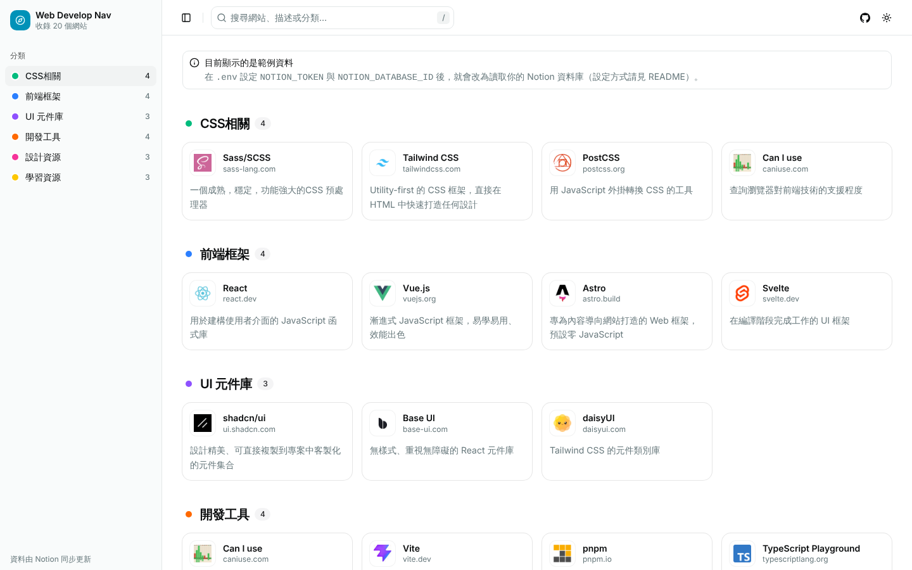
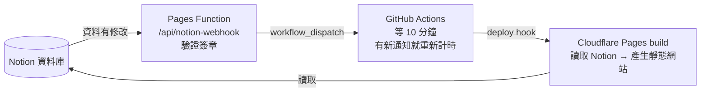

# Web Develop Nav

以 **Notion 資料庫當後台**的前端工具導航站。網站是純靜態（SSG），在 build 時讀取 Notion；Notion 修改後會自動重新 build。

- 框架：Astro 7 + React 19 + Tailwind CSS v4 + [shadcn/ui](https://ui.shadcn.com)（base-nova / Base UI）
- 版面參考：[WebNav](https://webnav.codefe.top/)（左側分類 + 卡片網格）；Notion 導航站參考：[M-Nav](https://nav.busyhe.com/)
- 部署：Cloudflare Pages（靜態網站 + 一個接收 Notion webhook 的 Pages Function）

<picture>
  <source media="(prefers-color-scheme: dark)" srcset="docs/screenshot-dark.png" />
  
</picture>

## 功能

- 📚 **Notion 即後台**：使用官方 Notion API 讀取資料庫，支援單選 / 多選分類
- 🔄 **自動重新 build**：Notion 有修改時收到 webhook，**等 10 分鐘，期間有新修改就重新計時**，之後才重新 build
- 🧭 **分類側邊欄**：順序與顏色跟 Notion 選項一致，捲動時自動標示目前分類；手機版為抽屜選單
- 🔍 **即時搜尋**：比對名稱、描述、網域與分類；按 `/` 或 `Ctrl / ⌘ + K` 聚焦
- 🖼️ **圖示**：`icon link` → Notion 頁面圖示 → 網站 favicon → 文字頭像，依序備援；Notion 上傳的圖示會在 build 時下載進網站
- 🌗 深色模式（淺色 / 深色 / 跟隨系統）、RWD

## 架構



- Notion 修改後的反映時間 ≈ Notion 送出通知（官方：通常 1 分鐘內，最慢 5 分鐘）＋ 10 分鐘等待 ＋ build 時間。
- build 時讀取 Notion 失敗（例如 token 失效、Notion 故障）會讓 build 失敗，網站繼續顯示上一版。
- 用量：每次「等 10 分鐘」結束只觸發 1 次 build（Cloudflare Pages 免費每月 500 次）；webhook 請求計入 Workers 免費每天 10 萬次；public repo 的 GitHub Actions 免費。

## Notion 資料庫欄位

| 欄位        | Notion 類型   | 說明                                                                  |
| ----------- | ------------- | --------------------------------------------------------------------- |
| `Name`      | 標題（Title） | 網站名稱。**沒有名字的資料不顯示**                                    |
| `link`      | URL           | 網站連結，可省略 `https://`。**沒有連結也會顯示**，只是卡片不能點     |
| `Desc`      | 文字          | 描述，可空白                                                          |
| `Type`      | 多選 / 單選   | 分類，可空白（歸到「未分類」）。側邊欄順序 = 選項順序；選項名稱開頭加 emoji（如 `🎨 CSS相關`）會當成分類圖示 |
| `icon link` | URL           | 自訂圖示網址，可空白                                                  |
| `Sort`      | 數字          | （選填）同分類內排序，數字小的在前；沒有此欄位時依建立時間排序        |

- 資料庫少了任何欄位都不會報錯，該欄位當作空白處理。
- 欄位名稱不分大小寫，可在 [`src/config/site.ts`](src/config/site.ts) 的 `notionPropertyAliases` 加入自己的欄位名稱。

## 本機開發

需求：Node.js ≥ 22.23.4、pnpm 10。

```bash
pnpm install
cp .env.example .env   # 填入 NOTION_TOKEN 與 NOTION_DATABASE_ID
pnpm dev               # http://localhost:4321
```

- `pnpm dev` 沒有設定 Notion 時會顯示範例資料，方便先調整畫面。
- `pnpm build` 一定要能讀到 Notion，否則 build 失敗。

## 部署到 Cloudflare Pages

所有環境變數都列在 [`.env.example`](.env.example)。

### 1. Notion integration

1. 到 [Notion Integrations](https://www.notion.so/profile/integrations) 建立 **Internal integration**，複製 **Internal Integration Secret**。
2. 打開資料庫 → 右上角 **⋯ → Connections** → 加入這個 integration。

### 2. 建立 Cloudflare Pages 專案

1. Cloudflare → **Workers & Pages** → 建立 Pages 專案並連結這個 GitHub repo（Git 整合）。
2. Production branch：`main`；Build command：`pnpm build`；Build output directory：`dist`。
3. **Settings → Variables and Secrets** 加入：`NOTION_TOKEN`、`NOTION_DATABASE_ID`、`PNPM_VERSION=10.28.0`。

### 3. Deploy hook 與 GitHub Actions

1. Pages 專案 **Settings → Builds → Add deploy hook**，分支選 `main`，複製網址（等同密碼，不要公開）。
2. GitHub repo → **Settings → Secrets and variables → Actions** 新增 secret：`CLOUDFLARE_DEPLOY_HOOK_URL` = 上一步的網址。
3. 建立 GitHub [fine-grained token](https://github.com/settings/personal-access-tokens)：只授權這個 repo，權限 **Actions: Read and write**。
4. 回到 Cloudflare Pages 加入：`GITHUB_DISPATCH_TOKEN`（上一步的 token）、`GITHUB_DISPATCH_REPO`（例如 `keon981/web-develop-nav`）。

> workflow 檔 `.github/workflows/notion-rebuild.yml` 必須在 repo 的預設分支（`main`）上才能被觸發。

### 4. Notion webhook

1. Notion integration 設定頁 → **Webhooks** → **Create a subscription**：
   - URL：`https://<你的專案>.pages.dev/api/notion-webhook`
   - 事件：勾選 Page 的 created / properties updated / deleted / undeleted，以及 Data source 的 schema updated（調整分類選項時）。
2. Notion 會送出一次驗證請求。到 Cloudflare **Workers & Pages → 專案 → 部署的 View details → Functions** 查看 log，找到
   `收到 Notion verification_token：...`，把 token 貼回 Notion 按 **Verify**。
3. 把同一個 token 設為 Cloudflare Pages 的 `NOTION_WEBHOOK_SECRET`，再重新部署一次讓設定生效。

## 指令

| 指令             | 說明                         |
| ---------------- | ---------------------------- |
| `pnpm dev`       | 開發伺服器                   |
| `pnpm build`     | 正式建置（輸出到 `dist/`）   |
| `pnpm preview`   | 預覽建置結果                 |
| `pnpm test`      | 單元測試（Vitest）           |
| `pnpm lint`      | ESLint                       |
| `pnpm typecheck` | `astro check` 型別檢查       |
| `pnpm format`    | Prettier 格式化              |

## 專案結構

```text
.github/workflows/notion-rebuild.yml   # 等 10 分鐘（重新計時）後呼叫 Cloudflare deploy hook
functions/api/notion-webhook.ts        # Cloudflare Pages Function：接收 Notion webhook
src/
├── config/site.ts          # 網站名稱、連結、favicon 服務、Notion 欄位對應
├── pages/index.astro       # 首頁：build 時讀取 Notion
├── lib/
│   ├── notion.ts           # Notion API → 導航資料（欄位規則、排序、圖示）
│   ├── nav-data.ts         # build 時的資料入口（下載 Notion 上傳的圖示、失敗即停止 build）
│   ├── notion-webhook.ts   # webhook 驗證簽章、觸發 GitHub Actions
│   └── demo-data.ts、search.ts、url.ts、category.ts …
├── components/
│   ├── nav/                # 版面：側邊欄、header、搜尋、卡片、主題切換
│   └── ui/                 # shadcn/ui 元件
└── hooks/                  # use-theme、use-active-section（scroll spy）、use-mobile
```

## 新增 shadcn 元件

```bash
npx shadcn@latest add <component>
```
